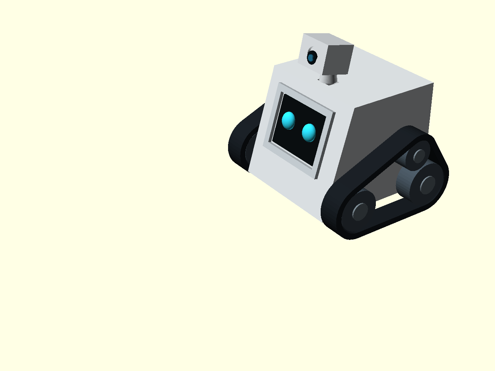

# ARC — Autonomous Robotic Companion

**A compact, expressive, tracked robot exploring embedded electronics, 3D-printed mechanisms, and self-hosted AI.**



> **Development status — October 2026:** Architecture selected; component integration, power delivery, drivetrain, charging, firmware, and local AI are **not yet bench-verified**. The cover image is a **concept illustration**, not a photo or validated CAD model. The final enclosure will have an **entirely backward-sloping front face** and may differ from the illustration.

## Project Owner

**Krish Shah**  
Virginia Tech  
**Contact:** [krish0728@vt.edu](mailto:krish0728@vt.edu)

## Project Overview

**ARC (Autonomous Robotic Companion)** is a personal engineering project to build a small, rechargeable robot that can **listen, talk, see, display expressions, and move** using two independently driven, real continuous tracks. It brings together embedded systems, robotics, CAD and 3D printing, battery-powered electronics, and locally hosted artificial intelligence.

The design uses a compact **wedge-shaped, cube-inspired enclosure** with a front face that slopes backward to angle its animated display upward. The target remains approximately **10–12 cm in height**, subject to real component fit and track geometry. A 2-inch color touchscreen will display ARC's facial expressions, while a built-in camera below the display will provide visual input. The earlier concept of a separate camera head is **not part of this design**.

ARC is designed to spend most of its time on a **magnetic-contact charging dock**, respond to interaction, and leave the dock for short, controlled movements. **Manual docking comes first**; independently finding and returning to the dock is a later engineering objective, not a finished capability.

Onboard control will use the **M5Stack CoreS3**. A separate **Raspberry Pi**, located **off the robot** and connected by Wi-Fi, is planned to host the local AI services. An optional external computer can help with more demanding processing when available. The intended core system will run on **free and open-source software**, without a required paid AI service or third-party AI API key.

**Engineering codename:** `CUBE-01` — used in design files and technical documentation. ARC is the project title; the robot's eventual character name is still open.

## Project Goals

- **Expressive interaction:** Animated eyes and facial states for idle, listening, thinking, speaking, charging, low battery, and connection status.
- **Voice conversation:** Capture audio onboard, process speech through a local service, and play spoken responses through ARC's speaker.
- **Visual awareness:** Capture images using the CoreS3 camera, with image understanding dependent on suitable external AI processing.
- **Real tracked movement:** Drive two independently controlled continuous side tracks, prioritizing slow, deliberate motion and torque over speed.
- **Rechargeable docking:** Support a stationary magnetic-contact charging cradle; add autonomous return and electrical charge confirmation in a later phase.
- **Local-first AI:** Keep speech recognition, language processing, and speech synthesis local wherever feasible.
- **Reproducible engineering:** Document hardware revisions, CAD, software, wiring, measurements, failures, and design decisions.

## System Architecture

```text
                     ARC — ONBOARD ROBOT
             +----------------------------------+
             | M5Stack CoreS3 (ESP32-S3)        |
             | 2-inch touch face + camera      |
             | microphones + speaker + Wi-Fi   |
             | sensors + onboard safety logic  |
             +----------------+-----------------+
                              |
                          M5Bus / I2C
                              |
             +----------------v-----------------+
             | M138-V11 4EncoderMotor module    |
             | left/right channels + encoders  |
             +----------------+-----------------+
                              |
                 Pololu gearmotors (2x)
                              |
                 REAL CONTINUOUS TRACKS

             +----------------------------------+
             | A014-D Battery Bottom3 (500mAh)  |
             | contact charging via A016 base  |
             +----------------------------------+
                              |
                       Wi-Fi / local LAN
                              |
             +----------------v-----------------+
             | OFFBOARD RASPBERRY PI            |
             | speech recognition + AI + TTS   |
             | local server / conversation     |
             +----------------+-----------------+
                              |
                  Optional external computer
                       (when available)
```

*This diagram shows the **planned logical architecture**, not an approved electrical power tree or validated physical stack. Motor power and the contact-charging path still require testing.*

## Current Hardware Selection

The following parts are the **selected prototype architecture**, **not confirmed purchases or tested integration**.

| Component | Qty. | Intended role | Status |
|---|---:|---|---|
| [M5Stack CoreS3 — K128](https://docs.m5stack.com/en/core/CoreS3) (regular version) | 1 | ESP32-S3 controller; 2-inch 320 × 240 touch display; camera, dual microphones, speaker, Wi-Fi and sensors | **Selected — untested** |
| [M5Stack 4EncoderMotor v1.1 — M138-V11](https://docs.m5stack.com/en/module/Module_4EncoderMotor_v1.1) | 1 | Motor driver with encoder feedback; two of four channels planned for the tracks | **Selected — untested** |
| [M5GO Battery Bottom3 — A014-D](https://docs.m5stack.com/en/base/Base_M5GO_Bottom3) | 1 | 3.7 V, 500 mAh onboard battery module and underside charging contacts | **Selected — power capacity unverified** |
| [M5GO Charging Base — A016](https://docs.m5stack.com/en/base/Base_M5GO_Charger) | 1 | Stationary **magnetic-contact** charging base; **not inductive/Qi charging** | **Selected — docked operation unverified** |
| [Pololu #5122 encoded 380:1 LP 6 V gearmotor](https://www.pololu.com/product/5122) | 2 | Slow, high-reduction drive for left and right tracks | **Selected — tracked-load performance untested** |
| [Pololu #4762 encoder cable](https://www.pololu.com/product/4762) | 2 | Motor and encoder connection; requires a verified connector adapter to M138-V11 | **Selected — harness mapping pending** |
| Printed track assemblies, sprockets, idlers and tensioners | 2 assemblies | Genuine continuous tracked locomotion | **CAD/mechanics to be developed** |
| External Raspberry Pi | 1 | Local speech, AI and control server over Wi-Fi | **Architecture confirmed — pipeline untested** |
| Optional external computer | As available | Additional AI/vision processing | **Optional** |

The CoreS3 already contains the screen, camera, microphones, and speaker hardware. This design **does not require the separate display, camera head, audio amplifier, or standalone controller from earlier prototypes**.

### CoreS3 features relevant to ARC

- **Display:** 2-inch full-color touchscreen for the animated face.
- **Camera:** Integrated GC0308 camera located **beneath the display**, not in a raised camera pod.
- **Audio:** Dual built-in microphones and onboard speaker for two-way voice interaction.
- **Connectivity:** Wi-Fi for communication with the offboard Pi.
- **Sensors:** Built-in near-field proximity/ambient light sensing, IMU, and power-management functions. Proximity sensing is **not** a reliable cliff detector or complete obstacle-avoidance system.

## Mechanical Design and 3D Printing

ARC's enclosure and track mechanism are intended to be predominantly 3D printed. The main visual requirements are:

- A compact, clean **cube/wedge silhouette** with the **whole front face sloping backward**.
- A neatly integrated CoreS3 display and the camera opening beneath it.
- **Two functional continuous tracks**, each powered independently, not decorative track covers over wheels.
- Low-speed motion with provision for sprockets, idler axles/bearings, track guides, and tension adjustment.
- Organized wiring, accessible USB/power controls, and a serviceable enclosure.
- A chassis underside and docking cradle designed around the charging-contact position.

**Proposed materials:** PLA for early fit-checks, PETG for structural parts, and TPU or articulated printed links for tracks. The actual belt pitch, sprockets, tolerances, mounts and track support bearings still need design and testing.

Earlier OpenSCAD models under `CUBE-01` were made for a **different electronics arrangement**. They are retained as visual/history references only. **A new CoreS3-based mechanical model is needed** before manufacturing-ready STL files can be claimed.

## Movement and Safety

Each side will use one encoded Pololu gearmotor and one continuous track. Differential control should enable forward/reverse motion, steering, and eventually pivot turns, subject to verified traction and motor torque.

A safety-first control system is planned to:

- Keep motors **stopped by default** at boot, reset, and power or communication faults.
- Enforce short, bounded movement commands with a watchdog/timeout.
- Stop on lost control connectivity and support an accessible manual stop/power-off path.
- Measure motor-startup, loaded-turn, and stall behavior before selecting final power arrangements.

**No dedicated cliff/drop sensors are planned for the initial build.** Testing will therefore be limited to **supervised, flat, contained areas away from stairs and ledges**. The integrated proximity sensor must not be treated as fall prevention.

## Charging Dock

The selected charging concept pairs the **A014-D Battery Bottom3** with the **A016 magnetic-contact charging base**. When docked, ARC should be able to remain in its usual resting location, show charging/idle animations, and eventually support conversation while powered. These simultaneous use-and-charge behaviors are still **engineering goals requiring electrical verification**.

The dock design needs to account for the fact that the track treads contact the floor while charging contacts are underneath the body. Initial alignment will be **manual**, followed later by a guided approach, homing cues, safe contact alignment, and confirmation that charging actually started. Autonomous docking is **not yet implemented**.

## Firmware, AI and Networking

### Onboard firmware

ARC will use customized ESP32-S3 firmware, exploring [Xiaozhi ESP32](https://github.com/78/xiaozhi-esp32) as the core and [Face for Xiaozhi](https://github.com/TechTalkies/Face-for-Xiaozhi) for expressions where compatible with CoreS3. Planned onboard responsibilities include:

- Display animation and expression state.
- Microphone capture, speaker playback, and camera capture.
- Secure local Wi-Fi connection to the external Pi.
- I2C motor control, encoder feedback, battery status, and default-STOP behavior.
- Basic local status/controls even if the AI service is unavailable.

### Offboard Pi and optional computer

The **Raspberry Pi remains external to the rover**. It is planned to handle the robot-facing local server, speech recognition, compact language processing, text-to-speech, and conversation state. An optional computer can perform heavier inference when available, with the Pi acting as the stable network endpoint.

Software being evaluated includes [Vosk](https://alphacephei.com/vosk/) for speech recognition, [llama.cpp](https://github.com/ggml-org/llama.cpp) for lightweight local models, and [eSpeak NG](https://github.com/espeak-ng/espeak-ng) for speech synthesis. Communication will follow a documented Xiaozhi-compatible protocol where feasible. **No integrated offline voice loop or performance benchmark has been completed yet.**

## What I Hope to Learn

Through ARC, I want to build hands-on experience in:

1. **Embedded systems:** ESP32-S3 firmware, audio/video peripherals, touchscreen graphics, real-time control, and Wi-Fi communication.
2. **Power electronics and PCB design:** Battery/current limits, charger behavior, motor driver integration, protective circuits, harnesses, and measurement-driven design. A small custom PCB may be considered later if necessary; one is not assumed at this stage.
3. **Mechanical design:** Parametric CAD, 3D printing, tracked drivetrain design, material choice, tolerances, assembly, and servicing.
4. **Robotics:** Differential drive, rotary encoders, traction, torque, control loops, fail-safe stops, and later dock approach.
5. **AI systems:** Self-hosted ASR, text generation, TTS, local networking, voice-tool control, and resource-constrained inference.
6. **System engineering:** Revising a design from actual test data, documenting failures, and validating the complete interaction between subsystems.

## Development Roadmap

| Phase | Main deliverable | Current status |
|---|---|---|
| **0 — Architecture and integration audit** | Confirm exact parts, three-module stack feasibility, motor power path, connector mapping and charger operation requirements | **In progress** |
| **1 — CoreS3 bench bring-up** | Display/face, microphones, speaker, camera, Wi-Fi and telemetry smoke tests | Not verified |
| **2 — Motor and track prototype** | Both encoded motors and real printed tracks move under bounded safe commands | Not started |
| **3 — Battery and magnetic-contact dock** | Measured motor/battery limits and repeatable safe contact charging, including powered-on behavior | Not verified |
| **4 — Local AI integration** | Pi-based speech-to-speech loop and CoreS3 protocol connection without paid APIs | Not verified |
| **5 — Revised CAD and assembly** | CoreS3-specific internal layout, functional drivetrain, serviceable chassis and dock | Not started |
| **6 — Future autonomous docking** | Locate dock, approach safely, align and electrically confirm charge | Future goal |
| **7 — System validation** | Repeatable safety, motion, battery, thermal, and voice tests | Future goal |

### Key engineering questions still open

1. **Stack compatibility:** Can CoreS3 K128, M138-V11, and Bottom3 A014-D physically and electrically operate together in the proposed order?
2. **Motor supply:** Can the 500 mAh battery and its available power rails handle the CoreS3 plus two motors during startup, turning and faults without unsafe drops or overheating?
3. **Powered-on docking:** Can the A016 contact base safely charge the battery while ARC is active, and how will charging be confirmed?
4. **Track mechanics:** What real torque, current, axle support and track tension are needed for reliable turning on an indoor floor?
5. **Software integration:** Which CoreS3 firmware/graphics revisions and lightweight local AI pipeline work reproducibly on the actual hardware?

These are **test gates**, not claims of working functionality. No parts in the new CoreS3 prototype stack have been confirmed ordered, received, or bench-tested in the current project record.

## Progress Log

### 2026-10-28 — Core design direction selected

- Defined the ARC companion-robot concept and `CUBE-01` engineering codename.
- Confirmed the wedge/cube form, **entirely sloped front**, 2-inch animated face, and two **real independent tracks**.
- Selected the integrated **CoreS3 K128** direction rather than separate screen/audio/camera assemblies.
- Selected **M138-V11**, **A014-D**, **A016**, two **Pololu #5122** motors and two **#4762** cables **for evaluation**.
- Established an **offboard Pi over Wi-Fi**, optional external computer, and free/local AI objective.
- Defined manual contact docking as the first charging step, with autonomous return as a later goal.
- Identified power, stacking, encoder harness and charging as immediate validation priorities.

### 2026-10-29 — README brought into line with current design

- Replaced the obsolete electronics descriptions with the selected CoreS3-based architecture.
- Clarified the integrated camera location, real tracked-drive design, local AI, and contact-charge dock.
- Kept the Pi description **model-independent** and retained the original cover illustration as conceptual artwork.
- No new hardware purchase, firmware build, electrical measurement, CAD fit, or successful dock test is claimed by this documentation update.

## Repository Organization

The intended repository structure is shown below. **Folders are a plan until created and populated.**

```text
ARC/
├── README.md
├── hero.png
├── cad/
│   ├── cores3-chassis/
│   ├── tracks/
│   └── dock/
├── hardware/
│   ├── bom/
│   ├── wiring-and-pinouts/
│   ├── power-tests/
│   └── pcb/                  # only if validated and needed
├── firmware/
│   └── cube01-cores3/
├── server/
│   ├── pi/
│   └── optional-pc/
└── docs/
    ├── architecture/
    ├── test-results/
    ├── decision-log/
    └── historical-designs/
```

## References

**Hardware and integration**

- [M5Stack CoreS3 documentation](https://docs.m5stack.com/en/core/CoreS3)
- [M5Stack 4EncoderMotor v1.1 documentation](https://docs.m5stack.com/en/module/Module_4EncoderMotor_v1.1)
- [M5Stack Battery Bottom3 documentation](https://docs.m5stack.com/en/base/Base_M5GO_Bottom3)
- [M5Stack battery-bottom charging base](https://docs.m5stack.com/en/base/Base_M5GO_Charger)
- [M5Stack compatible-stack reference](https://docs.m5stack.com/en/compatible_stack)
- [Pololu #5122 gearmotor](https://www.pololu.com/product/5122)
- [Pololu #4762 encoder cable](https://www.pololu.com/product/4762)

**Firmware and local AI**

- [Xiaozhi ESP32 firmware](https://github.com/78/xiaozhi-esp32)
- [Face for Xiaozhi](https://github.com/TechTalkies/Face-for-Xiaozhi)
- [ESP-IDF](https://github.com/espressif/esp-idf)
- [M5Unified](https://github.com/m5stack/M5Unified)
- [M5GFX](https://github.com/m5stack/M5GFX)
- [llama.cpp](https://github.com/ggml-org/llama.cpp)
- [Vosk](https://alphacephei.com/vosk/)
- [eSpeak NG](https://github.com/espeak-ng/espeak-ng)

---

**ARC — Autonomous Robotic Companion**  
*An engineering project in expressive embedded robotics, real tracked locomotion, 3D printing, and local-first AI.*
